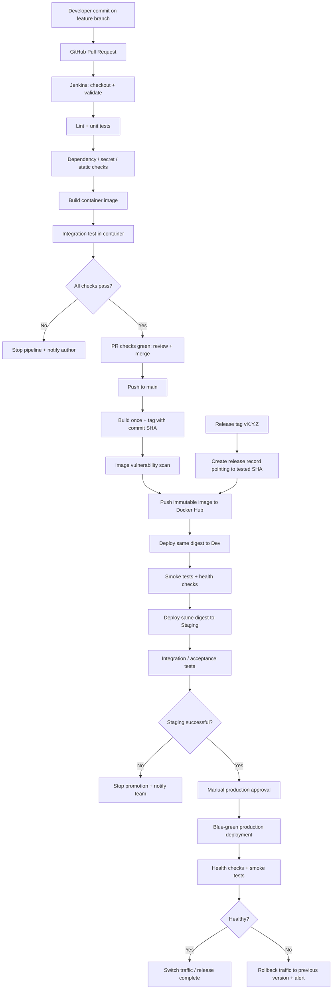

# CI/CD Pipeline Design: `sample-api`

**Prepared for:** Engineering Team  
**Application:** `sample-api` (Node.js API, containerised with Docker)  
**Repository:** https://github.com/rahulp-ht/sample-api  
**Proposed pipeline:** GitHub → Jenkins → Docker Hub → Dev → Staging → Production

## 1. Executive summary

This proposal adds repeatable quality and security checks to `sample-api` and promotes one immutable container image through dev, staging, and production. GitHub is the source of truth, Jenkins orchestrates CI/CD, and Docker Hub stores versioned images. Pull requests receive fast validation; merges to `main` produce a uniquely tagged image and deploy automatically to non-production environments. Production requires an explicit approval after staging checks pass.

The key release rule is **build once, deploy many**: the image digest built and tested by CI is the same artifact promoted to each environment. Environment-specific settings are injected at runtime and are not baked into the image.

## 2. Pipeline diagram

The editable Mermaid source is provided separately as `pipeline-diagram.mmd`.



## 3. Source control and triggers

### Branching model

- `main`: protected, releasable code only. Require pull-request review and successful required CI checks; prohibit direct pushes.
- `feature/<short-description>`: normal development branches, created from `main`.
- `fix/<short-description>`: non-emergency fixes.
- `hotfix/<short-description>`: urgent production fixes; still reviewed and tested through a PR.
- Release tags use semantic versioning, such as `v1.2.0`. A release tag must point to a commit that has already passed CI and staging.

### Trigger matrix

| Event | Pipeline behaviour |
|---|---|
| Pull request opened, synchronized, or reopened | Checkout PR head; lint, unit tests, secret/dependency/static checks, container build and integration tests. Do not publish a production image or deploy. |
| Push/merge to `main` | Repeat required checks, build the release candidate once, scan it, publish SHA-tagged image, then deploy to dev and staging. |
| Semantic version tag `vX.Y.Z` | Verify tag points to a tested commit; attach the semantic-version tag to the already-built image/digest and initiate the production approval/release workflow. If the registry cannot safely add a tag to an existing digest, copy/retag without rebuilding and verify the digest is unchanged. |
| Scheduled nightly run (optional) | Dependency and image vulnerability scans; notify maintainers of newly discovered issues. |

A failed required PR check blocks merging. A failed post-merge stage blocks promotion to the next environment.

## 4. Build and automated tests

Jenkins checks out the exact commit and uses a pinned Node.js runtime (for example, Node.js 20 LTS) and a reproducible dependency install. The repository should commit `package-lock.json`.

Suggested commands (adjust script names to match `package.json`):

```bash
npm ci
npm run lint --if-present
npm test
docker build --pull -t sample-api:"$GIT_COMMIT" .
docker run -d --name sample-api-test -p 3000:3000 sample-api:"$GIT_COMMIT"
curl --fail --silent --show-error http://localhost:3000/health
curl --fail --silent --show-error http://localhost:3000/version
curl --fail --silent --show-error http://localhost:3000/info
docker rm -f sample-api-test
```

### Test layers

- **Lint/static checks:** catch style problems, suspicious patterns, and common bugs before packaging.
- **Unit tests:** `test.js` verifies individual application behaviour, including expected status codes and response bodies.
- **Integration tests:** run the built container and call `/health`, `/version`, and `/info` over HTTP. This verifies the image starts and routes work together.
- **Smoke tests:** run after each deployment against the environment URL, not only localhost.

A command returning a non-zero exit code fails its stage. `curl --fail` fails on HTTP 4xx/5xx; missing routes, unexpected response bodies, container startup errors, or test assertions also fail the pipeline. Tests must have timeouts so a hung process cannot stall the build indefinitely.

## 5. Image publishing and artifact promotion

**Registry:** Docker Hub, using a private repository for team/prod workloads unless public distribution is intended.

**Image name:** `DOCKERHUB_USERNAME/sample-api`

**Tags:**
- `sha-<full-git-commit>` — unique, traceable build identifier; preferred deployment reference.
- `vX.Y.Z` — human-readable release tag attached to the same tested image digest.
- `latest` — optional convenience tag only; never use it as the deployment source of truth.

Example:

```bash
IMAGE="DOCKERHUB_USERNAME/sample-api"
SHA_TAG="sha-${GIT_COMMIT}"
docker build -t "${IMAGE}:${SHA_TAG}" .
docker push "${IMAGE}:${SHA_TAG}"
docker image inspect "${IMAGE}:${SHA_TAG}"
```

The pipeline records the registry digest (`sha256:...`) after publishing. Dev, staging, and production deployments all reference that digest (or the unique SHA tag plus digest verification). Do not rebuild for each environment. This ensures the artifact tested in staging is the artifact released to production and improves auditability and rollback.

## 6. Deployment and production strategy

### Environments

- **Dev:** automatic deployment after a successful main-branch build and image scan. Use for early smoke tests.
- **Staging:** automatic promotion of the same image digest after dev health checks pass. Use production-like configuration and run integration/acceptance tests.
- **Production:** deploy only after a semantic release is selected and an authorised approver approves the release. Require staging success first.

Each environment has its own runtime configuration, endpoint, credentials, network policy, and resource limits. Configuration changes do not require rebuilding the image.

### Production: blue-green deployment

Use blue-green deployment where the hosting platform supports two production target groups or equivalent service revisions. Deploy the new version to the inactive (green) environment, wait for readiness and health checks, run smoke tests, then switch load-balancer traffic. Keep the previous (blue) version available during the observation window.

This strategy is chosen because it makes rollback fast: if green fails health checks or error-rate/latency thresholds, switch traffic back to blue rather than trying to repair the live version in place. It does use extra capacity during deployment; if that cost is unacceptable, a controlled rolling deployment is a reasonable alternative.

**Approval gate:** after staging acceptance tests and before production deployment/traffic switch. Approval should be restricted to the service owner or designated on-call/release approver, and the approver identity/time should be recorded.

## 7. Secrets, configuration, and permissions

- Store Docker Hub credentials in **Jenkins Credentials** (or the organisation's secret manager) as a username plus access token. Use a scoped token, not the account password.
- Store deployment credentials in a secret manager or short-lived workload identity where supported. Prefer role-based access over long-lived cloud access keys.
- Never commit `.env` files, tokens, private keys, or credentials. Add secret scanning to PR checks and rotate any exposed secret immediately.
- Inject environment-specific configuration at runtime using the platform's environment/configuration mechanism. Keep secrets separate from non-secret config and separate dev, staging, and production values.
- Use separate deployment identities or roles per environment. PR jobs must not receive production credentials. Only the protected release job may request production deployment permissions.
- Apply least privilege: Jenkins checkout needs repository read access; image publishing needs push access only to the target image repository; dev/staging deploy jobs can modify only their own services; production deployment permission is gated and narrowly scoped.
- Mask credentials in Jenkins logs, avoid shell tracing (`set -x`) around secrets, and do not print environment variables.

## 8. Quality and security checks

The pipeline includes at least these checks:

1. **Dependency vulnerability scan:** run `npm audit --omit=dev` (or an approved SCA tool) and define a severity policy. Review exceptions explicitly; do not silently ignore findings.
2. **Container image scan:** scan the built image with Trivy or the organisation-approved scanner. Block release on Critical vulnerabilities and on High vulnerabilities according to the team's agreed policy; publish the scan report as a build artifact.
3. **Secret scan:** scan commits/PR diffs with Gitleaks or an equivalent tool. Any confirmed credential finding blocks merge.
4. **Static analysis/lint:** ESLint and, if available, SonarQube or an equivalent SAST tool. Fail on configured quality-gate violations.
5. **Image provenance and immutability:** record commit SHA, build URL, scan result, and image digest; do not overwrite SHA tags. Pin base images by version/digest where practical.

Security tools should be configured with documented thresholds and a process for time-limited, approved exceptions. A scan that cannot run should fail closed for a release unless the team explicitly approves a documented temporary bypass.

## 9. Failure handling, health checks, and rollback

| Failure point | Required response |
|---|---|
| Checkout, lint, unit test, or build fails | Stop immediately; mark the Jenkins run failed; retain logs and test reports; notify the PR author/team channel. No image publication or deployment. |
| Dependency, secret, static, or image scan fails | Block merge or release according to the gate; attach report; notify the owner. Do not promote the artifact. |
| Docker Hub push fails | Retry a small, bounded number of times; then fail and notify. Do not deploy an image that was not verified in the registry. |
| Dev health/smoke test fails | Stop promotion to staging; capture logs and container/service events; notify the team. |
| Staging acceptance test fails | Do not request production approval; preserve the known-good production version. |
| Production readiness/health check fails | Do not switch traffic to green; keep blue serving users. |
| Production fails after traffic switch | Automatically switch traffic back to blue if health/error-rate thresholds breach during the observation window; alert the on-call team and create an incident record. |

Health checks should verify both process readiness and application behaviour. Use bounded retries and a timeout, for example 10 attempts at 10-second intervals, and check the load balancer's target health as well as the `/health` endpoint. Retain the previous image digest and deployment configuration so rollback does not depend on rebuilding or on a mutable `latest` tag.

**Notifications:** send concise status messages to the team’s chosen channel/email with repository, branch/tag, commit SHA, failed stage, build URL, and report links. Never include secrets in notifications.

## 10. Evidence from the hands-on lab

Attach the real screenshots captured during the Jenkins/GitHub Actions lab. Do not substitute mock images.

- **Evidence A — Deliberately failing run:** screenshot showing the intentional test or pipeline failure, the failed stage, and the relevant error.
- **Evidence B — Fixed run:** screenshot showing the corrected commit and successful pipeline stages.
- **Evidence C — Image publication:** screenshot of the successful Docker Hub push and the resulting SHA tag/digest, if completed in the lab.
- **Evidence D — Application validation:** screenshot or console output showing `/health`, `/version`, and `/info` responding successfully.

Suggested placement: save images under `evidence/` in the repository and embed them here, for example:

```markdown


```

The evidence images were not available while preparing this draft, so the placeholders above must be replaced with screenshots from your actual lab runs before submission.

## 11. Deliverables and acceptance criteria

- This design document and the editable Mermaid source file.
- Repository containing `pipeline.sh` and `test.js`: https://github.com/rahulp-ht/sample-api
- Evidence screenshots for the deliberate failure and fixed success, stored in the repository or submitted alongside the document.

The design is accepted when PR checks block bad changes, the same immutable image digest is promoted through dev and staging, production requires approval, failures stop promotion, and rollback can restore the last known-good version without rebuilding.
